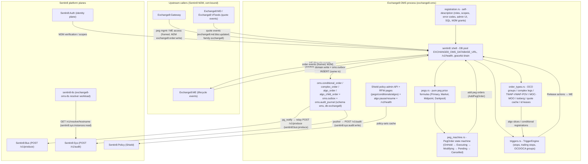

# Exchange8:OMS

## 1. Summary

Exchange8:OMS (Order Management System) is the peg/iceberg supervision and
conditional-order trigger engine of the exchange8 vertical - the
capital-markets matching tier of the Sentin8 platform. It supervises
**pegged orders** (primary / market / midpoint peg, dark variant), slices
**iceberg orders** into display slices at the matching engine, and holds
**stop / stop-limit / trailing-stop / conditional (OCO, bracket) orders** in
its trigger engine, releasing them to Exchange8:ME only when their trigger fires
(they never rest in the ME book). It is a *pricing and scheduling engine*,
not a classic order-management system: order states above the fill are
owned by Exchange8:Gateway, books and fills by Exchange8:ME; OMS owns the peg state
machine, slice plans, and trigger conditions. The service binary wraps the
pure order-type cores in the Sentin8 platform shell (`sentin8::shell`):
axum HTTP/TLS surface, `--print-registration` self-registration, DB pool,
allocator, and graceful drain. Durable surfaces are deliberately small -
conditional/complex/algo order rows in schema `oms` (database `exchange8`),
a local `oms.outbox` relayed to Sentin8:Bus, and an `oms.audit_journal`
pushed to Sentin8:Sys - while working peg state is memory-resident and
rebuildable from upstream replay.

## 2. Motivation

- **Defensible peg pricing.** A peg order's price is recomputed as the
  market moves; the formula, the monotonic market-peg ratchet, and the
  limit-conversion rule must be provably identical run-to-run. The pricing
  core is a *pure* function over the quote snapshot - the same quote always
  yields the same price or the same hold/convert outcome - so audit can
  reconstruct every reprice decision.
- **Conditional orders that never rest unprotected.** Stops and trailing
  stops are held inside the OMS until their reference price breaches the
  trigger; releasing them to the book only at trigger time keeps hidden
  intent out of the public book and centralizes trigger semantics.
- **Iceberg execution without leaking size.** Display-slice reserve
  accounting lets an institution show a small slice while the hidden
  reserve is only revealed when the previous slice trades out - with a
  documented re-arm behavior at the ME (tail reinsertion).
- **No bespoke infrastructure.** Identity, TLS, policy administration,
  event durability, and audit delivery are all platform services
  (Sentin8:Auth, `sentin8-tls`, Shield, Sentin8:Bus, Sentin8:Sys); the
  binary only owns the peg/slice/trigger domain.
- **Single-writer determinism per instrument.** Pegs on one instrument share
  one quote-driven evaluation path with the same sharding shape as the
  matching engine - no per-order locking to reason about.

## 3. Architecture & High-Level Design

The service is an axum binary over the shared `sentin8::shell` crate. The
HTTP surface carries health, the shared Shield policy-admin API, the
declared RFW admin pages + data endpoints, and the algo pause/resume
surface; the heavy lifting is in four pure sibling modules
(`order_types.rs`, `pegs.rs`, `peg_machine.rs`, `triggers.rs`) whose
inputs are quotes and order events and whose outputs are ME actions
(submit / replace / withdraw / release / cancel). The runtime wiring
(`runtime.rs`) spawns the instrument-sharded evaluation plane (quote
consumer (SSE direct-consumer pattern - one long-lived Bus stream
connection per epoch, per-message acks) + per-shard evaluators + the
algo scheduler pump + the egress
writer), and `events.rs`/`stats.rs` carry the typed emission vocabulary
and the supervision gauges. Working pegs and trigger holds live in
memory; the durable surfaces are the conditional/complex/algo order
tables, the local outbox, and the audit journal.

The shell boots registration, the DB pool (`EXCHANGE8_OMS_DATABASE_URL`),
the Shield admin router, and the graceful drain; the pure modules are free
of tokio, DB, and clock dependencies, which is what makes the state-machine
and pricing tests exact.

## 4. Key Traits and Data Structures

- **Peg state machine** (`PegOrder`) - one managed peg per order: lifecycle
  states OnHold → Executing → Modifying → Pending → Cancelled with the
  transition table driven entirely by quote evaluations. Every evaluation
  returns the ME action to perform (Submit / Replace / Withdraw / None); the
  machine never touches the ME itself - the shell is the caller.
- **Peg price formulas** (`compute_peg_price`) - the pure pricing function
  over the four peg types: `Primary` joins the peg's own side
  (bid + offset / ask − offset), `Market` joins the opposite side with a
  monotonic ratchet (never reprices worse once working), `Midpoint`
  computes (bid+ask)/2 + offset only when both sides are live and
  un-crossed and validates the result against the doubled-tick grid, and
  `Darkpool` is the midpoint formula with the order always hidden.
  Outcomes are Actionable(price) / Hold / ConvertToLimit(limit).
- **Iceberg slice plan** (`IcebergState`) - total quantity, maximum display
  floor, currently displayed quantity, and the slice counter. A fill
  reduces the displayed slice; when the slice is exhausted and reserve
  remains, a new slice arms at `min(max_floor, remaining)` (slice-count
  increments - the ME sub-order identity); cancel of the displayed slice
  pulls it while the reserve stays.
- **Trigger conditions** (`ConditionalOrder` + `TriggerEngine`) - each held
  order watches one reference price (last / bid / ask) at a trigger
  threshold; trailing stops ratchet the threshold monotonically behind the
  best reference seen (buy stops trail down, sell stops trail up, never
  loosening). A fired order is released to Exchange8:ME as market or
  stop-limit (limit carried on the release); OCO/OCA group semantics resolve
  sibling cancellations in the engine, not per-order.
- **OCO registry & brackets** (`OcoRegistry`) - id-driven groups where the
  first leg to fire executes and its siblings cancel (idempotent re-fire is
  a no-op); client cancellation of one leg breaks the whole bracket.
- **Complex orders** (`ComplexOrder`) - atomic all-or-none multi-leg
  evaluation: the order executes only when every leg can fill its full
  quantity simultaneously at its limit.
- **Slice schedulers** (`AlgoEngine`) - TWAP (uniform split with remainder
  spread), VWAP (profile-weighted slices), POV (percentage of realized
  interval volume, open-ended until the parent is exhausted), and the
  MOC/MOO/LOO/LOC auction queue draining at the uncross.
- **Quote cache** (`QuoteCache`) - per-instrument BBO/EBBO snapshots with a
  change-driven dirty set draining into peg re-evaluation.
- **Child-order id lease & idempotency gate** - batch ids leased from the
  platform-managed sequence facility and a client idempotency-key dedup
  returning the originally assigned id.

## 5. Rationale, Trade-offs, and Alternatives

- **Pattern choices.**
  - *Pure cores + thin shell.* The pricing formulas, the peg transition
    table, the trigger evaluation, and the slice schedulers are deterministic
    structs; the shell owns I/O, identity, and persistence. The same quote
    sequence always yields the same ME action stream, which is the property
    that makes reprice auditing and restart re-evaluation trustworthy.
  - *Pricing domain owned locally.* The peg type enum is mirrored in the OMS
    even though the contracts crate declares one - the OMS owns the pricing
    semantics and stays decoupled from wire-contract layout churn.
  - *Outbox-first events.* Domain writes and `oms.outbox` inserts share one
    transaction before the relay forwards them, so a Bus outage delays but
    never loses a lifecycle event (idempotency key = outbox row id).
- **Dispatching.** Peg kinds, trigger references, and algo kinds are
  closed enums, not trait objects: the policy space is a venue-defined
  closed set (the four peg types, three references, three algo kinds), and
  the pure functions stay table-testable with no vtable on the hot path.
- **Concurrency.** One instrument-sharded, single-writer evaluation
  surface (same hash shape as the ME shards) means no per-order mutex;
  quote events from MD/VFeeds and lifecycle events from ME enter the same
  shard queue so evaluation order is the event order.
- **Rejected alternatives.**
  - *Persisting working peg state row-by-row*: adds commit latency to the
    reprice path and couples pricing to pool health; working pegs are
    rebuildable from Gateway replay of the peg backlog and the Clearing
    mirror's day-so-far set, so only the conditional/algo skeletons are
    durable.
  - *Putting stops in the ME book with a stop field*: leaks trigger terms
    into the public book and spreads trigger semantics across services;
    holding stops in the OMS keeps release-at-trigger in one place.
  - *A separate dark matching pool*: dark pegs route to the ME as hidden
    midpoint-priced orders - the dark variant is a visibility flag, not a
    second engine.
  - *Rounding midpoint prices to the nearest tick*: would silently trade at
    a price no quote implies; the doubled-tick validation rejects off-grid
    midpoints into an explicit hold instead.

## 6. Internal Implementation & Invariants (Private Design)

- **Pricing evaluation order (per quote, per peg).** one-sided quote → Hold;
  crossed/locked quote → Hold (unsafe to price from); locked quote also
  blocks Midpoint (no midpoint inside a zero spread); Midpoint/Darkpool
  validate the computed integer midpoint against the doubled-tick grid and
  reject into the state machine's error branch (Withdraw a working slice)
  rather than rounding; the Market-peg ratchet applies after computation
  (bid: lower is worse, ask: higher is worse); the limit relation
  (bid ≤ limit, ask ≥ limit) runs last and fails into ConvertToLimit.
- **Conversion is terminal for repricing.** Once a peg reaches its limit it
  is a plain limit order (`converted_to_limit = true`); further quotes are
  ignored, and the only remaining transitions are cancel/fill. If a slice
  was working it is replaced at the limit price; if none was, one is
  submitted at the limit.
- **Trailing ratchet discipline.** `trail_extreme` tracks the best reference
  seen (min for buy stops, max for sell stops); the trigger price trails it
  by the offset and is only ever updated in the protective direction - a
  market move that would loosen the stop is ignored.
- **OCO group resolution inside one tick.** `TriggerEngine::on_tick`
  evaluates every held order on that instrument, collects fired groups, and
  cancels remaining siblings after the sweep - one tick can release two
  buys and cancel nothing, release one and cancel a sibling, or fire
  nothing. Client cancel of one leg propagates to siblings; re-fire of a
  terminal group is a no-op.
- **Atomic complex gate.** `all_fillable` requires every leg's fillable
  quantity (at limit-or-better) to cover its leg quantity; a single short
  leg means nothing executes - no partial leg fills ever.
- **Slice conservation.** TWAP slices sum exactly to the parent quantity
  (remainder distributed one-per-interval front-loaded); VWAP weights the
  remaining quantity by the profile tail; POV participates at
  `interval_volume × percent / 100` capped by the remaining quantity;
  every path stops at `remaining == 0`.
- **Quote-driven re-evaluation set.** `QuoteCache` marks an instrument dirty
  only when the snapshot actually changed, dedups the drain set, and the
  supervisor re-prices exactly the pegs on those instruments - O(pegs on
  instrument) per quote event, bounded by the instrument peg cap.
- **Idempotency.** Duplicate `AddPegOrder` requests with the same gateway
  idempotency token no-op to the original ack; the `IdempotencyGate` maps
  client keys to assigned child ids so a duplicate submission returns the
  original id rather than leasing a new one.
- **Invariants always true:** a peg never prices through its client limit
  (violation converts, not rejects the price); a working Market peg never
  reprices worse than its current price (the ratchet is monotonic); a
  Midpoint/Darkpool price is never accepted off the doubled-tick grid;
  held conditional orders never rest in the ME book before their trigger;
  trailing stops only tighten; OCO groups are terminal after the first
  fire; iceberg reserve is never displayed or matchable beyond the floor;
  no tenant context on a connection means zero rows everywhere.

## 7. Unresolved Questions / Future Designs

- The quote-event producer seam: the OMS consumer is bound to the declared
  `exchange8:md:bbo:updated` vocabulary (payload
  `exchange8::contracts::events::BboUpdated`, family `exchange8`); the
  MD/VFeeds outbox write sites are their own wiring pass (consumers may
  run ahead of producers - pegs hold their last evaluation until the first
  quote arrives).
- The direct-stream intake (Gateway → OMS peg management, the ME
  lifecycle readers, and the `stop_last` trade-print feed) rides the
  platform's framed-stream sender pass - the shard queues and intake
  registries (`register_peg` / `ShardInput`) are live; no peer frame
  senders exist yet.
- Instrument peg-cap configurability per environment (the
  `INSTRUMENT_PEG_CAP` default is 5 000; tenant-visible configuration is
  an admin-surface decision).

---

**Architecture & Design:** exchange8:oms and its underlying concepts were designed by [Hamid Jahanzad](https://www.linkedin.com/in/hamidjahanzad/).
